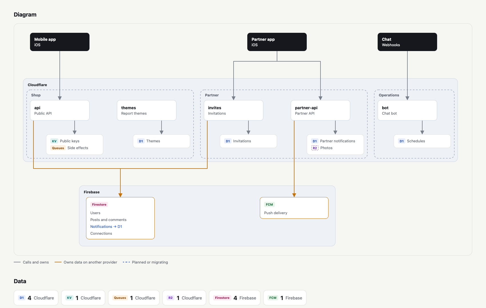

# 🗺️ stackmap

**Turn one YAML file into an architecture map of your whole stack.**

[](https://github.com/Ryu0118/stackmap/actions/workflows/test.yml)
[](LICENSE)
[](https://swift.org)
[](https://developer.apple.com/macos/)

Describe your clients, services, stores, and every piece of data once in
`stackmap.yml`. stackmap renders it as a single self-contained HTML page: a
diagram in the style of an infrastructure drawing, plus a table of where each
piece of data lives and who owns it.

<picture>
  <source media="(prefers-color-scheme: dark)" srcset="asset/example~dark.png">
  
</picture>

## Features

- 🧭 **One source of truth:** Keep the stack in a YAML file next to your code,
  and review changes to it like any other diff.
- 🔍 **Render by scope:** Show the whole system with tabs per scope, or render
  just one part with `--scope`.
- 🛡️ **Strict validation:** Unknown keys, broken references, and duplicate ids
  are all reported at once, each with the path of the offending key.

## Installation

stackmap needs macOS 26 or later.

### Mise ([jdx/mise](https://github.com/jdx/mise))

```sh
mise use -g github:Ryu0118/stackmap
```

## Quick Start

1. Create `stackmap.yml`:

   ```yaml
   version: 1
   title: My Platform

   scopes:
     - id: shop
       label: Shop

   providers:
     - id: edge
       label: Cloudflare

   stores:
     - id: sql
       label: D1
       provider: edge

   clients:
     - id: mobile
       label: Mobile app
       scopes: [shop]
       calls: [api]

   services:
     - id: api
       label: api
       provider: edge
       scopes: [shop]

   data:
     - id: users
       label: Users
       store: sql
       owner: api
       identifiers: [users]
   ```

2. Render it:

   ```sh
   stackmap render stackmap.yml -o stackmap.html
   ```

3. Render one scope only:

   ```sh
   stackmap render stackmap.yml -o shop.html --scope shop
   ```

A larger example is in [Examples/stackmap.yml](Examples/stackmap.yml). The
full schema, validation rules, and diagram layout are described in
[Configuration File](Sources/StackmapKit/StackmapKit.docc/ConfigurationFile.md).

## Commands

| Command | Description |
| --- | --- |
| `stackmap render [file] [-o path] [--scope id]` | Render `file` (default `stackmap.yml`) to `path`, or to standard output. |

## License

stackmap is available under the MIT license. See [LICENSE](LICENSE).
